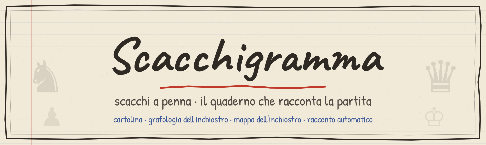
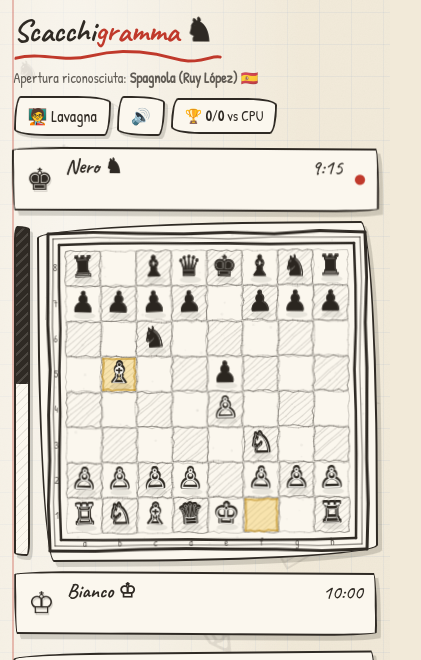
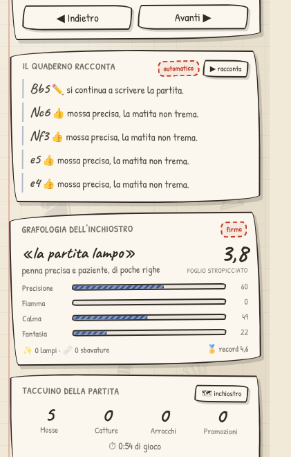
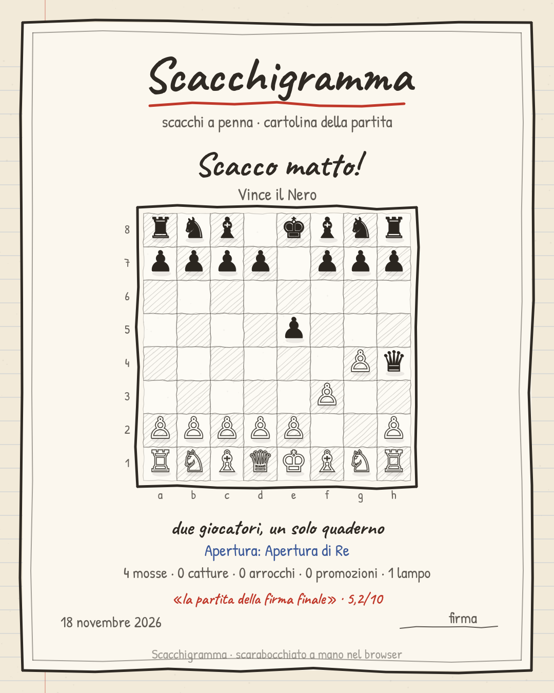

<p align="center">
  
</p>

<h1 align="center">Scacchigramma</h1>

<p align="center">
  <b>Scacchi a penna, disegnati nel browser.</b><br>
  Ogni partita diventa una pagina di quaderno: le mosse si commentano da sole,<br>
  la penna ti dà un voto in calligrafia e alla fine la partita diventa una cartolina.
</p>

<p align="center">
  
  
  
  
</p>

---

## Che cos'è

Scacchigramma è un gioco di scacchi completo che vive su un foglio: la scacchiera è
tracciata a mano, i pezzi sono glifi con ombre e tremolii, le caselle si riempiono di
tratteggi. Non è un'imitazione di una scacchiera digitale: è un quaderno che si apre
nel browser.

Dietro il disegno c'è un gioco vero: regole complete (arrocco, en passant, promozione,
stallo, tripla ripetizione, regola delle 50 mosse), orologi da 10 minuti, due giocatori
sullo stesso dispositivo o una CPU con tre livelli.

Funziona su telefono, tablet e desktop, in verticale e in orizzontale, senza installare
nulla: è una pagina statica, senza backend e senza account.

## Le funzioni che non trovi altrove

| | |
|---|---|
| **Il quaderno racconta** | Ogni mossa diventa una riga scritta a mano con un giudizio (`✨ lampo`, `👍 buona`, `🩹 sbavatura`) calcolato dal guadagno di valutazione, non da un testo preconfezionato. |
| **Racconto automatico** | Il pulsante ▶ *racconta* rilegge la partita da sola, mossa per mossa, con la scacchiera che torna indietro e il commento in evidenza: un audiolibro della partita. |
| **Grafologia dell'inchiostro** | La penna analizza come giochi e firma la partita: un nome poetico («la partita del pedone incoronato»), un voto in calligrafia su 10 e quattro tratti — Precisione, Fiamma, Calma, Fantasia. La pagina migliore resta salvata come record. |
| **Cartolina della partita** | Un PNG disegnato a mano con posizione finale, apertura, numeri, firma e voto: pronto da scaricare e condividere. |
| **Mappa dell'inchiostro** | Le case più battute si riempiono di tratteggio: si vede a colpo d'occhio dove si è combattuto. |
| **Suggerimento spiegato** | Il motore propone la mossa e dice perché: «nettamente la migliore (+1.8 pedoni)», «si porta a casa la Donna», «matto forzato». |

## Screenshot

<p align="center">
  
  &nbsp;&nbsp;
  
</p>

<p align="center">
  <em>Su telefono: scacchiera, quaderno narrante, grafologia e taccuino, con la barra dei comandi sotto il pollice.</em>
</p>

<p align="center">
  
</p>

<p align="center">
  <em>La cartolina generata dal gioco: scacchiera finale, apertura, numeri della partita, firma e voto.</em>
</p>

## Come si gioca

- **Mosso**: tocca un pezzo — le case legali si illuminano — poi tocca la destinazione. Funziona anche il trascinamento.
- **Modalità**: due giocatori sullo stesso schermo, oppure contro la CPU (facile / media / difficile) scegliendo il colore.
- **Comandi**: Nuova partita, Annulla (anche a partita finita), Ruota la scacchiera, Suggerimento, Suoni e cambio foglio (Quaderno ✏️ / Lavagna 🧑‍🏫).
- **Revisione**: tocca una mossa nello storico per rivedere la posizione; `←` e `→` scorrono la partita.

### Scorciatoie da tastiera

| Tasto | Azione |
|---|---|
| `H` | Suggerisci una mossa |
| `U` | Annulla l'ultima mossa |
| `F` | Ruota la scacchiera |
| `N` | Nuova partita |
| `T` | Cambia foglio (quaderno / lavagna) |
| `M` | Mappa dell'inchiostro |
| `←` `→` | Mossa precedente / successiva |
| `Esc` | Torna al presente |

## Come funziona

- **React 19 + TypeScript**, build con **Vite 7** e Tailwind CSS 4.
- **Scacchiera in canvas**: griglia, caselle e bordi sono tracciati da una piccola libreria di
  linee "traballanti" (`src/lib/rough.ts`), i pezzi sono glifi Unicode con ombre, animazioni e
  particelle d'inchiostro; la lavagna ha polvere di gesso.
- **Regole**: [chess.js](https://github.com/jhlywa/chess.js) 1.4 gestisce legalità, scacco matto,
  patta e notazione.
- **Motore**: minimax con potatura alpha-beta, valutazione materiale + tabelle posizionali e
  ordinamento delle catture (`src/lib/ai.ts`).
- **Suoni**: sintetizzati in WebAudio all'istante (`src/lib/sound.ts`) — nessun file audio.
- **Memoria locale**: palmarès, preferenze, record di grafologia in `localStorage`.
- **Build a file unico**: `vite-plugin-singlefile` incorpora CSS, font e codice in un solo
  `dist/index.html` (~600 kB), così il gioco funziona anche aperto da disco.

## Installazione in locale

Serve **Node.js 20.19+ oppure 22.12+** (richiesto da Vite 7) e npm.

```bash
git clone https://github.com/jeaders/scacchigramma.git
cd scacchigramma
npm install
npm run dev
```

Apri l'indirizzo stampato nel terminale (di solito <http://localhost:5173>).

Per provarlo da smartphone sulla stessa rete:

```bash
npm run dev -- --host
```

e apri `http://<ip-del-computer>:5173` dal telefono.

### Build di produzione

```bash
npm run build     # genera dist/index.html autosufficiente
npm run preview   # lo serve in locale per un controllo finale
```

Puoi provare il gioco live su https://scacchigramma.netlify.app/ (PC, smartphone, tablet).
| Comando | Cosa fa |
|---|---|
| `npm run dev` | server di sviluppo con ricarica immediata |
| `npm run build` | build di produzione in `dist/` |
| `npm run preview` | anteprima locale della build |

## Struttura del progetto

```text
src/
├─ App.tsx                 stato della partita, orologi, revisione, racconto, persistenza
├─ index.css               temi quaderno/lavagna, layout responsive, animazioni
├─ components/
│  ├─ BoardCanvas.tsx      scacchiera disegnata su canvas, animazioni, input touch
│  ├─ SidePanel.tsx        stato, comandi, storico, quaderno, grafologia, taccuino, palmarès
│  └─ Overlays.tsx         promozione e fine partita (con salvataggio cartolina)
├─ lib/
│  ├─ ai.ts                valutazione e minimax alpha-beta
│  ├─ calligraphy.ts       firma della partita, voto e tratti della penna
│  ├─ chessGame.ts         pezzi, glifi, catture, orologio
│  ├─ commentary.ts        il commento di ogni mossa
│  ├─ openings.ts          riconoscimento delle aperture
│  ├─ postcard.ts          disegno e download della cartolina PNG
│  ├─ rough.ts             tratti "a mano" (rette, rettangoli, cerchi, tratteggi)
│  ├─ sound.ts             effetti sonori WebAudio
│  └─ theme.ts             palette dei due fogli
└─ assets/fonts/           Patrick Hand e Caveat (woff2, OFL)
docs/                      banner e screenshot del README
```

## Licenza

Codice, testi, disegni e suoni sono **© [Alex Mirici](https://alexmirici.netlify.app) Web Developer** — tutti i diritti riservati**:
vedi [LICENSE](LICENSE). Nessun permesso d'uso è concesso senza autorizzazione scritta.

Il progetto include componenti di terzi con licenze proprie — chess.js (BSD-2-Clause),
i font Caveat e Patrick Hand (SIL OFL 1.1) e le librerie runtime React, clsx e
tailwind-merge (MIT): i testi completi sono in
[THIRD-PARTY-NOTICES.md](THIRD-PARTY-NOTICES.md).
